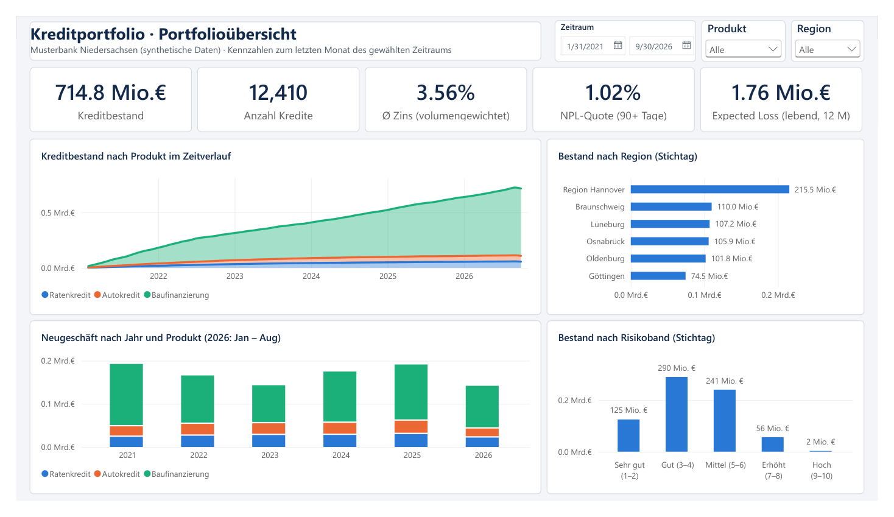
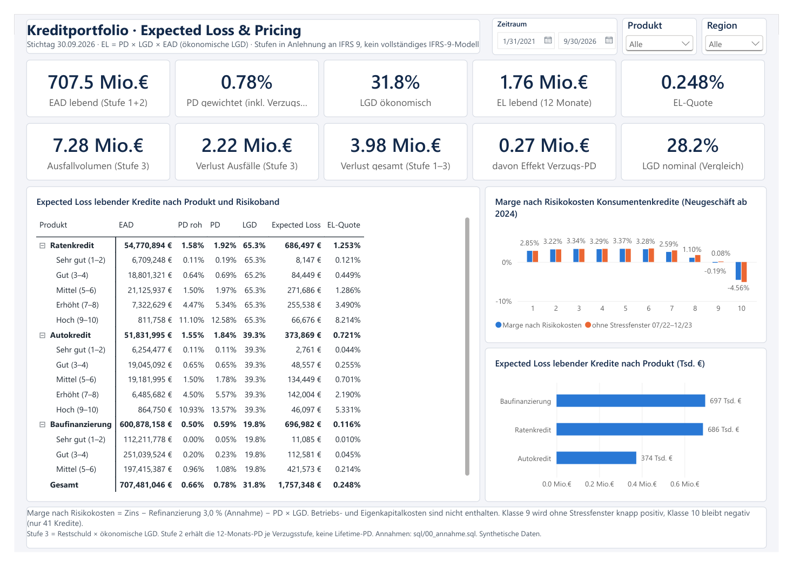
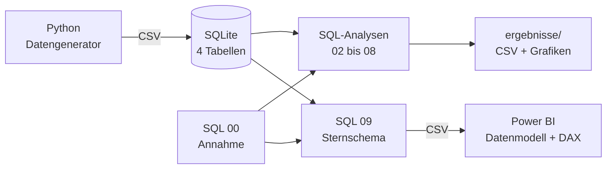
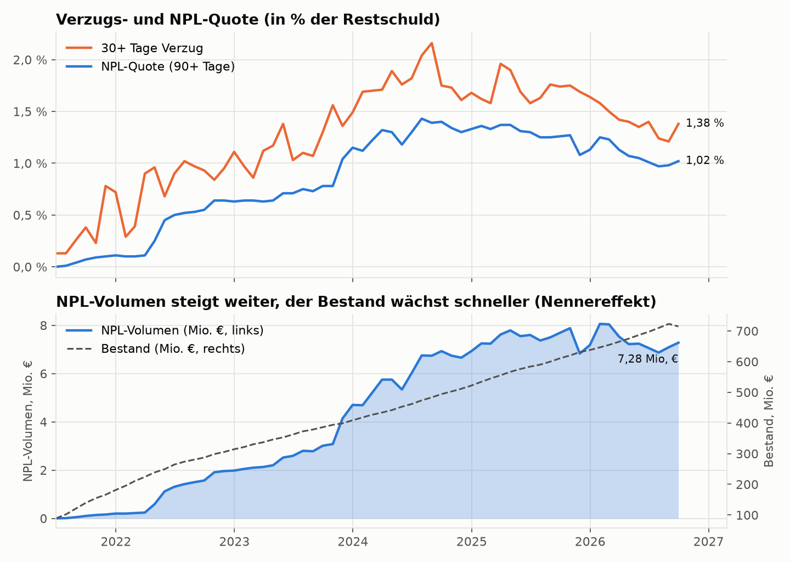
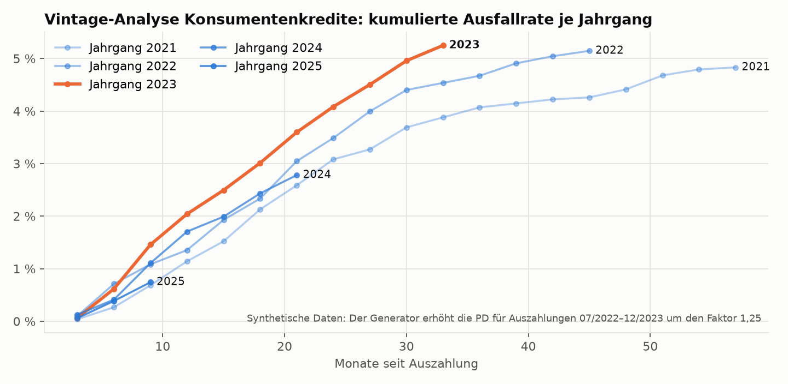
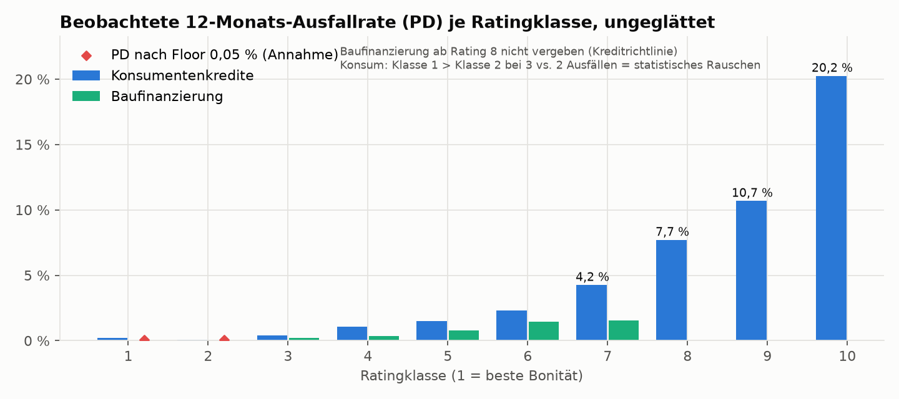
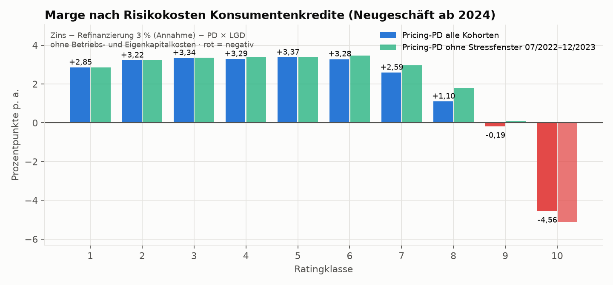
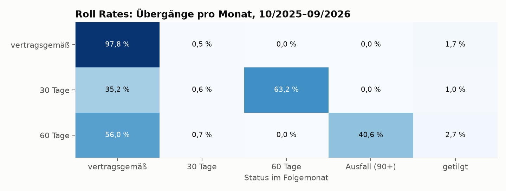
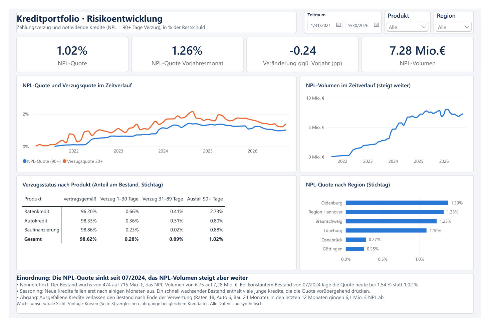
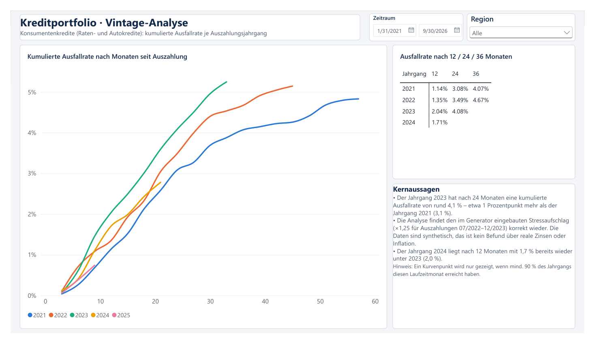

# Kreditportfolio-Risikoanalyse mit SQL und Power BI

End-to-End-Analyse eines Retail-Kreditportfolios: von der Datenbank über SQL-Risikoanalysen bis zum
Power-BI-Datenmodell. Betrachtet werden Ratenkredite, Autokredite und Baufinanzierungen einer fiktiven
Regionalbank in Niedersachsen, 01/2021 bis 09/2026.

Eigenes Portfolio-Projekt (10/2026) zur Vertiefung von **SQL** und **Power BI**, ergänzend zur
Weiterbildung „Python und Data Science im Finanzwesen“ (IU Internationale Hochschule).





Alle vier Dashboard-Seiten: siehe Abschnitt [Power-BI-Dashboard](#power-bi-dashboard).
Alle Änderungen der Methodik-Überarbeitung mit Vorher/Nachher-Werten: [`CHANGES.md`](CHANGES.md).

## Leitfragen

1. Wie entwickeln sich Zahlungsrückstände und Ausfälle im Portfolio und welche Jahrgänge sind auffällig?
2. Wie hoch ist der erwartete Verlust (Expected Loss) nach Produkt und Ratingklasse, und welcher Verlust ist bei bereits ausgefallenen Krediten zu erwarten?
3. Ist das Pricing risikogerecht? Deckt der Zins in jeder Ratingklasse Refinanzierung und Risikokosten?

## Kernergebnisse (Stichtag 30.09.2026)

Alle Werte beruhen auf synthetischen Daten. Sie zeigen, wie die Methoden funktionieren, und sind keine
Aussage über einen realen Kreditmarkt.

| Kennzahl | Wert | Einordnung |
|---|---|---|
| Kreditbestand | **714,8 Mio. €** (12.410 Kredite) | 85 % Baufinanzierung, 15 % Konsumentenkredite |
| NPL-Quote (90+ Tage Verzug) | **1,02 %** bei **7,28 Mio. €** NPL-Volumen | Die Quote fällt seit dem Höchststand von 1,43 % (07/2024), das NPL-Volumen steigt aber von 6,75 auf 7,28 Mio. €. Grund ist vor allem der wachsende Bestand (Nennereffekt), siehe [Einordnung der NPL-Quote](#einordnung-der-npl-quote) |
| Expected Loss lebender Kredite (12 Monate) | **1,76 Mio. €**, EL-Quote **0,25 %** | Ratenkredite 1,25 %, Autokredite 0,72 %, Baufinanzierung 0,12 %. Mit Verzugs-PD für Kredite im Rückstand und ökonomischer LGD |
| Verlustschätzung Ausfälle (Stufe 3) | **2,22 Mio. €** auf 7,28 Mio. € Restschuld | Restschuld × ökonomische LGD. Mit nominaler LGD wären es 1,93 Mio. € |
| Verlust gesamt | **3,98 Mio. €** | 1,76 Mio. € lebend + 2,22 Mio. € ausgefallen. Der bisher ausgewiesene EL von 1,54 Mio. € enthielt die Ausfälle nicht |
| LGD (abgeschlossene Verwertungen) | nominal Raten **64 %**, Auto **38 %**, Bau **15 %** · ökonomisch **65 %**, **39 %**, **20 %** | Ökonomisch = Erlöse über die Abwicklungsdauer mit 3 % abgezinst. Die Werte treffen die im Generator vorgegebenen Mittelwerte 65/40/15 % |
| PD bei Zahlungsrückstand | 30 Tage **29,1 %**, 60 Tage **43,3 %** (12 Monate) | Direkt aus Kohorten geschätzt. Verkettete monatliche Roll Rates liefern nur Untergrenzen (25,7 % bzw. 40,6 %) |
| Vintage 2023 | **4,08 %** kumulierte Ausfälle nach 24 Monaten | vs. 3,08 % beim Jahrgang 2021. Die Analyse findet den im Generator eingebauten Stressaufschlag (×1,25 für Auszahlungen 07/2022–12/2023) korrekt wieder. |
| Marge nach Risikokosten | Klasse **9: −0,19 pp**, Klasse **10: −4,56 pp** | Ohne Stressfenster in der Pricing-PD wird Klasse 9 knapp positiv (+0,08 pp), Klasse 10 bleibt negativ (−5,12 pp). Ohne Betriebs- und Eigenkapitalkosten. Kleine Fallzahl (117 bzw. 41 Kredite im Neugeschäft ab 2024) |

**Empfehlungen** (im Rahmen des synthetischen Szenarios)

- **Pricing nachschärfen:** Risikoaufschlag für Ratingklasse 10 deutlich erhöhen oder diese Klasse im
  Konsumentenkredit nur noch mit Sicherheiten vergeben. Klasse 9 deckt die Risikokosten nur knapp und nur dann,
  wenn die Stressjahrgänge nicht in die PD eingehen. Betriebs- und Kapitalkosten sind dabei noch nicht gedeckt.
- **Jahrgänge 07/2022 bis 12/2023 eng überwachen:** Ihre Ausfallkurven liegen über denen älterer Jahrgänge.
  Frühwarnsignale (30-Tage-Rückstand) in diesem Segment priorisieren.
- **Frühwarnung lohnt sich:** Von den Krediten mit 30 Tagen Rückstand werden 35 % im Folgemonat wieder
  vertragsgemäß bedient, 63 % rutschen in den 60-Tage-Verzug. Innerhalb von 12 Monaten fallen 29 % aus.
  Das Inkasso sollte im ersten Monat ansetzen.
- **Ausfallbestand steuern:** Die Verlustschätzung für bereits ausgefallene Kredite (2,22 Mio. €) ist höher als
  der Expected Loss des gesamten lebenden Bestands. Die Verwertung der 19 Baufinanzierungen im Ausfall
  (5,33 Mio. € Restschuld) bestimmt den Großteil davon.

## Daten

Die Daten sind **synthetisch** und werden mit `src/01_daten_generieren.py` reproduzierbar erzeugt (fester Seed 42).
Sie enthalten keine realen Kundendaten. Die Annahmen orientieren sich an typischen Strukturen deutscher
Retailbanken:

| Generator-Annahme | Umsetzung |
|---|---|
| Produktmix | 55 % Ratenkredite, 30 % Autokredite, 15 % Baufinanzierungen (nach Stückzahl) |
| Zinsumfeld | Niedrigzins bis 03/2022, Zinsanstieg bis 09/2023, leichter Rückgang ab 2024 |
| Neugeschäft | Baufinanzierung bricht 2023 um rund 40 % ein |
| Kreditrichtlinie | Max. Kapitaldienstquote 35 % (Konsum) bzw. 45 % (Bau), keine Baufinanzierung ab Rating 8 |
| Ausfallrisiko | PD je Ratingklasse 0,1 % bis 12 % p. a., Faktor Ratenkredit 1,30 und Autokredit 1,00, Zuschläge für Selbständige, hohe Kapitaldienstquote und Auszahlungen 07/2022 bis 12/2023 (×1,25) |
| Ausfalldefinition | 90 Tage Zahlungsverzug. Rückstände bauen sich über 30, 60 und 90 Tage auf, ein Teil wird geheilt |
| Verwertung | Abwicklung Raten 18, Auto 6, Bau 24 Monate. LGD je Produkt (Raten ca. 65 %, Auto ca. 40 %, Bau ca. 15 %, abhängig vom Beleihungsauslauf). Verwertungs-EAD = Restschuld + 3 Raten |

| Tabelle | Zeilen | Inhalt |
|---|---|---|
| `kunden` | 20.000 | Alter, Beschäftigung, Nettoeinkommen, Region |
| `kredite` | 20.000 | Produkt, Betrag, Laufzeit, Zins, Rate, Ratingklasse, Kapitaldienstquote, Beleihungsauslauf |
| `performance_monat` | 517.679 | Restschuld, Tage überfällig und Status je Kredit und Monatsultimo |
| `verwertung` | 669 | Ausfälle mit EAD, Verwertungserlös und Status (454 abgeschlossen, 215 laufend) |

## Architektur



## SQL-Analysen

| Datei | Fragestellung | SQL-Techniken |
|---|---|---|
| `00_annahme.sql` | **Alle Modellannahmen an einer Stelle** (Tabelle `annahme`) | `CREATE TABLE`, `INSERT`, Parameter per Unterabfrage |
| `01_schema.sql` | Datenbankschema | Primär-/Fremdschlüssel, CHECK-Constraints, Indizes |
| `02_datenqualitaet.sql` | 12 Prüfungen auf Vollständigkeit, Konsistenz, Lücken | LEFT JOIN Anti-Join, UNION ALL, `LAG()` |
| `03_portfolio_ueberblick.sql` | Bestand, Neugeschäft, Region, Ratingverteilung | Aggregation, volumengewichtete Mittel, `SUM() OVER ()` |
| `04_rueckstaende_npl.sql` | NPL-Quote und NPL-Volumen im Zeitverlauf, Zerlegung der Quote, DPD-Buckets | CTE, `CASE`, `LAG(…, 12)` für Vorjahresvergleich |
| `05_vintage_analyse.sql` | Kumulierte Ausfallraten je Jahrgang | Monatsindex aus Datumsarithmetik, `VALUES`-CTE, `HAVING` |
| `06_roll_rates.sql` | Übergangsmatrix der Verzugsstufen | `LEAD()` mit `PARTITION BY`, Anteile per Fensterfunktion |
| `07_expected_loss.sql` | PD je Rating und Verzugsstufe, LGD nominal und ökonomisch, EL je Stufe, Überleitung | Sichten (`CREATE VIEW`), Kohortenanalyse, `power()` für Abzinsung, mehrstufige CTEs |
| `08_marge_nach_risikokosten.sql` | Deckt der Zins Refinanzierung und Risikokosten? Test und Variante ohne Stressfenster | `CROSS JOIN`, Wiederverwendung der Sichten aus 07 |
| `09_powerbi_datenmodell.sql` | Sternschema für Power BI | `CREATE TABLE AS`, rekursive CTE für Datumsdimension |

Alle Ergebnistabellen: [`ergebnisse/ERGEBNISSE.md`](ergebnisse/ERGEBNISSE.md)

## Grafiken











## Power-BI-Dashboard

Interaktiver Bericht mit vier Seiten und synchronisierten Filtern für Zeitraum, Produkt und Region.
Alle Kennzahlen stimmen mit den SQL-Ergebnissen überein (z. B. Bestand 714,8 Mio. €, NPL-Quote 1,02 %,
EL lebend 1,76 Mio. €, Verlust gesamt 3,98 Mio. €). Die Marge nach Risikokosten je Ratingklasse ist in DAX
und SQL identisch (per DAX-Abfrage geprüft).

**1. Portfolioübersicht**


**2. Risikoentwicklung** (NPL-Quote, NPL-Volumen und Einordnung)


**3. Vintage-Analyse**


**4. Expected Loss & Pricing** (Stufen 1 bis 3, Marge nach Risikokosten mit Stressvariante)


**Datenmodell:** Sternschema mit vier Dimensionen (`dim_datum`, `dim_produkt`, `dim_region`, `dim_rating`)
und fünf Faktentabellen (`fact_bestand_monat`, `fact_neugeschaeft`, `fact_vintage`, `fact_expected_loss`,
`fact_risikokosten`), Daten per Power Query aus den CSV-Dateien geladen.

Warum eine Faktentabelle für alle Stufen? Ausgefallene Kredite (Stufe 3) haben dieselbe Körnung
(Stichtag × Produkt × Region × Rating) und dieselben Dimensionen wie lebende Kredite. Mit PD = 100 % gilt
EL = PD × LGD × EAD auch für sie. Die Spalte `stufe` trennt die Teilsummen, eine zweite Faktentabelle würde
nur Beziehungen und Measures verdoppeln. `fact_risikokosten` hat dagegen eine andere Körnung (Produkt × Rating,
ohne Datum und Region) und ist deshalb eine eigene Tabelle.

| Ordner / Datei | Inhalt |
|---|---|
| `powerbi/Kreditportfolio_Dashboard.pbix` | **Hier starten:** fertiger Bericht für Power BI Desktop |
| `powerbi/Kreditportfolio_Dashboard.pdf` | PDF-Export aller vier Seiten |
| `powerbi/Kreditportfolio_Dashboard.pbip` + Ordner `.Report` / `.SemanticModel` | Derselbe Bericht als Power-BI-Projekt (TMDL/PBIR), für Versionierung und zum Lesen im Browser. Zum Öffnen reicht die `.pbix` |
| `powerbi/measures.dax` | Alle 36 DAX-Measures (NPL-Quote, Vorjahresvergleich, Expected Loss je Stufe, Marge nach Risikokosten, Vintage …) |
| `powerbi/daten/` | Dimensions- und Faktentabellen als CSV |
| `powerbi/theme_kreditportfolio.json` | Farbdesign zum manuellen Laden (Anleitung). Der Bericht selbst nutzt die Kopie in `.Report/StaticResources` |
| `powerbi/ANLEITUNG_POWER_BI.md` | Aufbau des Berichts Schritt für Schritt |

> **Daten aktualisieren nach dem Klonen:** In Power BI unter *Start > Daten transformieren > Parameter bearbeiten*
> (*Home > Transform data > Edit parameters*) den Parameter `Datenordner` auf den lokalen Pfad zu `powerbi\daten\`
> setzen und anschließend *Aktualisieren* (*Refresh*).

## Projektstruktur

```
├── src/
│   ├── 01_daten_generieren.py   # synthetische Rohdaten nach data/raw/
│   ├── 02_sql_pipeline.py       # Datenbank, Annahmen, Analysen, Power-BI-Export
│   └── 03_grafiken.py           # Grafiken für dieses README
├── sql/                         # 00 Annahme, 01-09: Schema, Prüfungen, Analysen, Datenmodell
├── ergebnisse/                  # Ergebnis-CSVs, ERGEBNISSE.md, grafiken/
├── powerbi/                     # Datenmodell, DAX, Design, Anleitung
├── CHANGES.md                   # Methodik-Überarbeitung mit Vorher/Nachher
└── requirements.txt
```

## Ausführen

```bash
pip install -r requirements.txt
python src/01_daten_generieren.py
python src/02_sql_pipeline.py
python src/03_grafiken.py
```

Laufzeit ca. 30 Sekunden. Der Zufallsgenerator hat einen festen Seed, ein erneuter Lauf erzeugt dieselben
Daten und überschreibt `ergebnisse/` und `powerbi/daten/` mit identischen Dateien (getestet mit pandas 3.1,
NumPy 2.5, Matplotlib 3.11). Die Datenbank `data/kreditportfolio.db` kann zusätzlich mit jedem SQLite-Client
(z. B. DB Browser for SQLite oder DBeaver) geöffnet werden, um die Abfragen in `sql/` einzeln auszuführen.
Dafür zuerst `00_annahme.sql` und den Kopf von `07_expected_loss.sql` (Sichten) ausführen.

## Annahme

Alle gesetzten Annahmen stehen an **einer** Stelle: Tabelle `annahme` in
[`sql/00_annahme.sql`](sql/00_annahme.sql). SQL 07, 08 und 09 lesen nur von dort, das Power-BI-Modell
bekommt die Werte über die exportierten Faktentabellen. Ein geänderter Wert wirkt nach einem neuen Lauf von
`src/02_sql_pipeline.py` überall.

| Parameter | Wert | Wofür |
|---|---|---|
| `refinanzierung_pa` | 3,0 % p. a. | Refinanzierungskosten in der Marge nach Risikokosten (fest, vereinfacht) |
| `pd_floor` | 0,05 % | Untergrenze je Ratingklasse, angelehnt an den Retail-PD-Floor nach Basel III final (CRR3) |
| `diskontsatz_pa` | 3,0 % p. a. | Abzinsung der Verwertungserlöse über die Abwicklungsdauer (ökonomische LGD) |
| `workout_kosten` | 0 % der EAD | Interne Abwicklungskosten (Standard 0 %, zum Testen änderbar) |
| `stressfenster_von` / `_bis` | 01.07.2022 / 31.12.2023 | Variante der Pricing-PD ohne Kredite aus diesem Auszahlungsfenster |

## Methodische Hinweise

**Einordnung der NPL-Quote**<a id="einordnung-der-npl-quote"></a>

Die NPL-Quote ist ein Bruch: NPL-Volumen geteilt durch Bestand. Sie fällt von 1,43 % (07/2024) auf
1,02 % (09/2026), obwohl das NPL-Volumen von 6,75 auf 7,28 Mio. € steigt. Drei Gründe:

1. **Nennereffekt:** Der Bestand wächst von 474 auf 715 Mio. €. Bei konstantem Bestand von 07/2024 läge die
   Quote heute bei 1,54 %.
2. **Seasoning:** Neue Kredite fallen erst nach einigen Monaten aus. Ein schnell wachsender Bestand enthält viele
   junge Kredite, die die Quote vorübergehend drücken.
3. **Abgang nach der Verwertung:** Ausgefallene Kredite bleiben nur bis zum Ende der Abwicklung im Bestand
   (Raten 18, Auto 6, Bau 24 Monate). In den 12 Monaten bis 09/2026 gingen so 6,14 Mio. € NPL ab.

Die wachstumsneutrale Sicht sind die **Vintage-Kurven**: Sie vergleichen Jahrgänge bei gleichem Kreditalter.
Deshalb zeigen SQL 04, die Grafik 01 und die Power-BI-Seite *Risikoentwicklung* das NPL-Volumen immer neben der Quote.

**Expected Loss in Anlehnung an IFRS 9** (kein vollständiges IFRS-9-Modell)

| Stufe | Kredite | EAD | Ansatz | Verlust |
|---|---|---|---|---|
| 1 vertragsgemäß | 12.104 | 704,9 Mio. € | 12-Monats-EL mit Rating-PD | 1,46 Mio. € |
| 2 Rückstand 30/60 Tage | 91 | 2,6 Mio. € | 12-Monats-EL mit Verzugs-PD | 0,30 Mio. € |
| 3 Ausfall 90+ | 215 | 7,3 Mio. € | Restschuld × ökonomische LGD (PD = 100 %) | 2,22 Mio. € |

Was zu einem vollständigen IFRS-9-Modell fehlt: Lifetime-PD für Stufe 2, zukunftsgerichtete Szenarien,
Abzinsung des EL mit dem Effektivzins und ein formales Kriterium für eine signifikante Erhöhung des
Kreditrisikos. Rückstand ist hier nur ein Indikator für Stufe 2.

**PD**

- Rating-PD = beobachtete 12-Monats-Ausfallrate je Produktgruppe und Ratingklasse aus vier Jahreskohorten
  (09/2022 bis 09/2025). Die Kohorten überlappen: Ein Kredit kann in mehreren Jahren beobachtet werden.
- Für das **Pricing** und die PD-Tabelle zählen alle nicht ausgefallenen Kredite (jährliche Ausfallrate). Für die
  **Stufe-1-EL** zählen nur Kredite ohne Rückstand am Kohortenstichtag, weil Kredite im Rückstand ihre eigene
  Verzugs-PD bekommen. Sonst würden diese Ausfälle doppelt gezählt.
- **Verzugs-PD:** 12-Monats-PD für Kredite mit 30 bzw. 60 Tagen Rückstand, aus allen Monatsultimos bis 09/2025
  geschätzt (stark überlappende Beobachtungen, alle Produkte gepoolt). Monatliche Roll Rates sind keine
  12-Monats-PDs: 63,2 % × 40,63 % ≈ 25,7 % ist nur eine Untergrenze, weil geheilte Kredite später erneut ausfallen.
- **PD-Floor 0,05 % (Annahme):** greift nur bei Baufinanzierung Klasse 1 und 2 (beobachtet 0 Ausfälle). Die
  Kurve wird nicht geglättet. Rohe PD und PD nach Floor werden beide ausgewiesen.
- Konsum Klasse 1 (0,22 %) liegt über Klasse 2 (0,09 %). Das sind 3 gegenüber 2 Ausfällen, also statistisches
  Rauschen und kein Befund.
- Die Tabelle der Baufinanzierung endet bei Klasse 7, weil die Kreditrichtlinie ab Rating 8 keine
  Baufinanzierung zulässt.
- Raten- und Autokredite sind in der PD als „Konsumentenkredit“ gepoolt, obwohl der Generator für Ratenkredite
  einen PD-Faktor von 1,30 und für Autokredite 1,00 setzt. Die gepoolte PD unterschätzt daher Ratenkredite und
  überschätzt Autokredite.

**LGD**

- Nur abgeschlossene Verwertungen: 454 von 669. Für Baufinanzierungen sind es 18 Fälle, der Wert ist
  entsprechend unsicher.
- Nominale LGD = 1 − Erlös / EAD. Ökonomische LGD zinst die Erlöse über die tatsächliche Abwicklungsdauer
  (18/6/24 Monate) mit 3 % ab und zieht Abwicklungskosten ab (Standard 0 %). Der Haupt-EL nutzt die ökonomische
  LGD, die nominale wird zum Vergleich gezeigt.
- Die EAD der Verwertung ist Restschuld plus 3 offene Raten, die EAD im EL ist die Restschuld zum Stichtag.
  Die LGD wird also auf einer etwas höheren Basis gemessen, als sie im EL angewendet wird.
- Die gemessenen LGDs treffen die im Generator vorgegebenen Mittelwerte (65/40/15 %). Das bestätigt die
  Berechnung, ist aber kein unabhängiger Befund.

**Marge nach Risikokosten**

- Marge nach Risikokosten = Sollzins − Refinanzierung (3,0 %, Annahme) − PD × ökonomische LGD.
  Betriebs- und Eigenkapitalkosten sind nicht enthalten.
- Kredite aus dem Stressfenster haben in den Kohorten eine höhere 12-Monats-PD (Konsum 2,27 % gegenüber 1,61 %).
  Darum gibt es eine Variante der Pricing-PD ohne diese Kredite. Klasse 9 wechselt damit das Vorzeichen
  (−0,19 → +0,08 pp), Klasse 10 bleibt negativ.
- Die Analyse findet den im Generator eingebauten Stressaufschlag (×1,25 für Auszahlungen 07/2022–12/2023) korrekt wieder.
  Das ist eine Plausibilitätsprüfung der Methode und keine Aussage über reale Zinsen oder Inflation.

**Regionale Unterschiede** der NPL-Quote entstehen vor allem durch einzelne große Baufinanzierungen im
Ausfall (Konzentrationsrisiko), nicht durch die Region selbst.

## Lizenz

MIT, siehe [`LICENSE`](LICENSE). Die Daten sind synthetisch.

## Werkzeuge

SQL (SQLite), Power BI, DAX, Python, pandas, NumPy, Matplotlib

---

**Ashraf Al Keilani** | Hannover | [LinkedIn](https://www.linkedin.com/in/ashraf-al-keilani)
