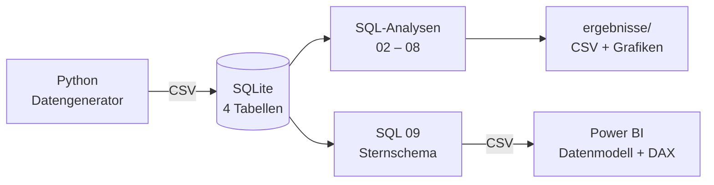
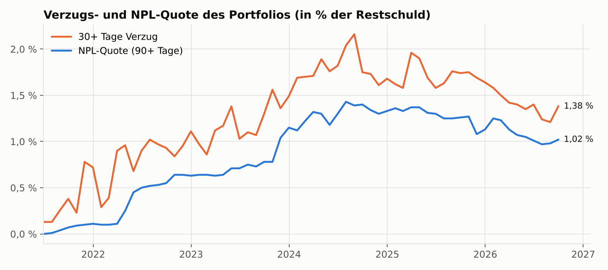
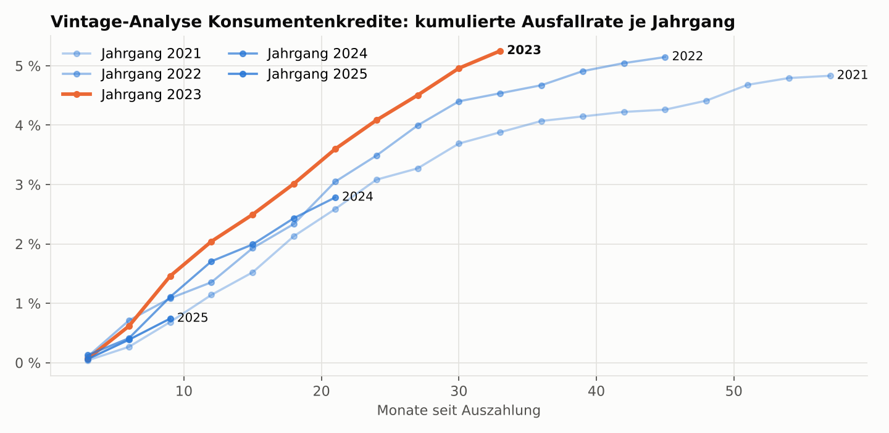
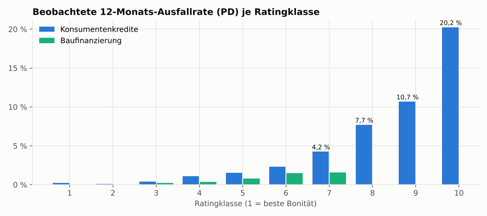
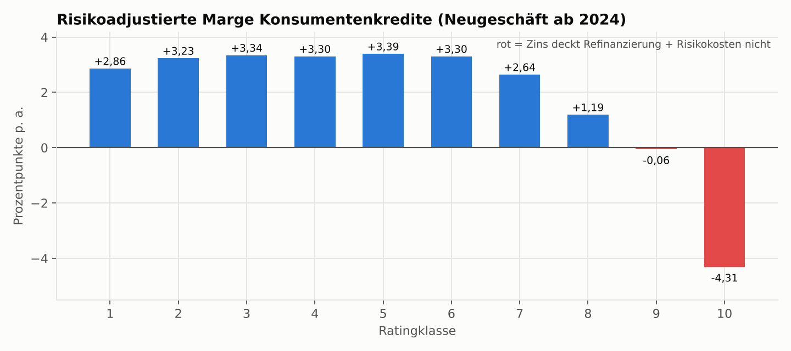
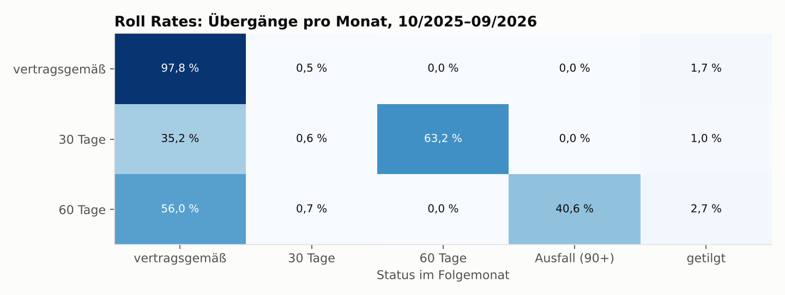
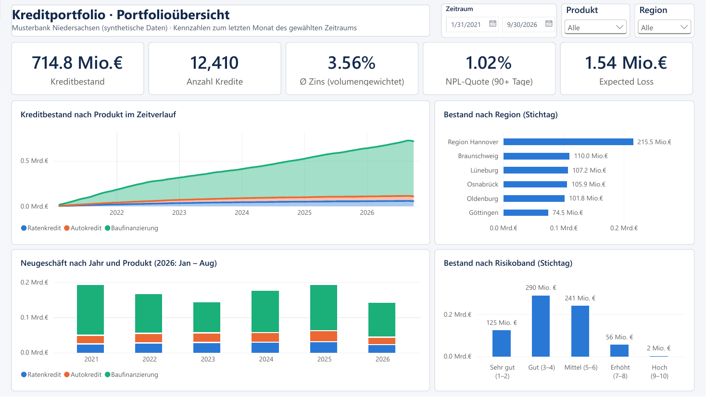
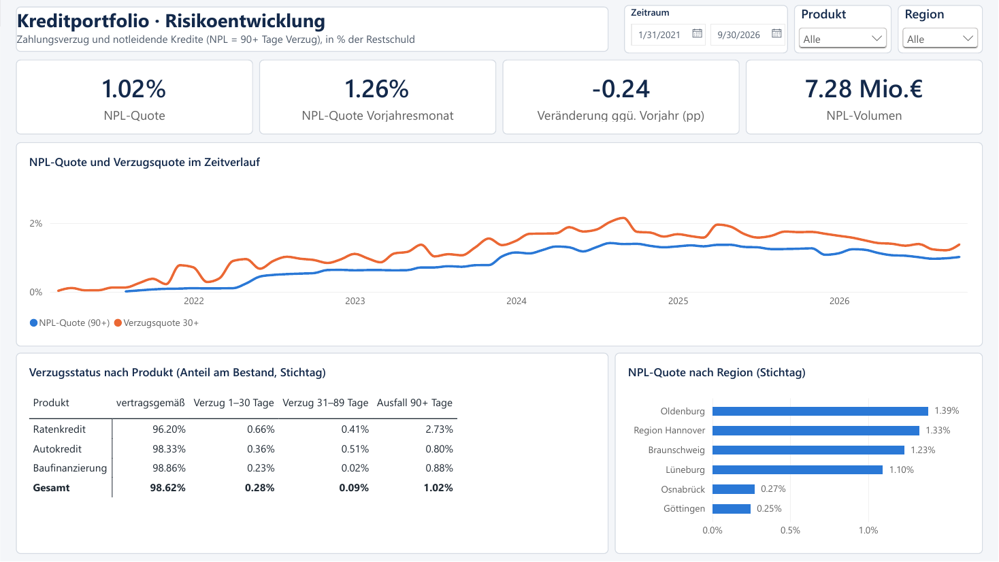
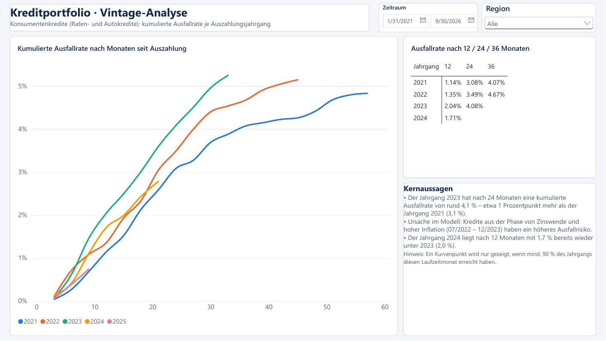
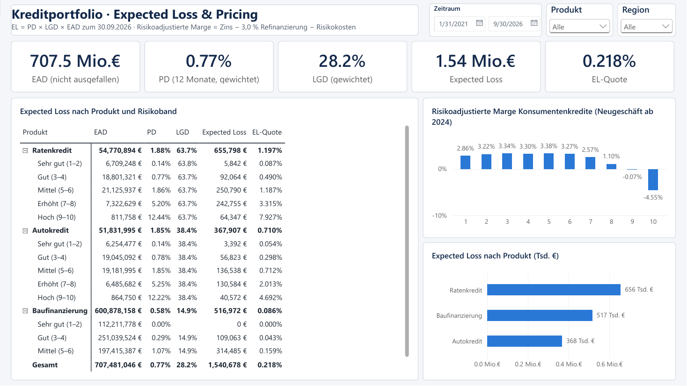

# Kreditportfolio-Risikoanalyse mit SQL und Power BI

End-to-End-Analyse eines Retail-Kreditportfolios: von der Datenbank über SQL-Risikoanalysen bis zum
Power-BI-Datenmodell. Betrachtet werden Ratenkredite, Autokredite und Baufinanzierungen einer fiktiven
Regionalbank in Niedersachsen, 01/2021 – 09/2026.

Eigenes Portfolio-Projekt (10/2026) zur Vertiefung von **SQL** und **Power BI** – ergänzend zur
Weiterbildung „Python und Data Science im Finanzwesen“ (IU Internationale Hochschule).

## Leitfragen

1. Wie entwickeln sich Zahlungsrückstände und Ausfälle im Portfolio – und welche Jahrgänge sind auffällig?
2. Wie hoch ist der erwartete Verlust (Expected Loss) nach Produkt und Ratingklasse?
3. Ist das Pricing risikogerecht – deckt der Zins in jeder Ratingklasse Refinanzierung und Risikokosten?

## Kernergebnisse (Stichtag 30.09.2026)

| Kennzahl | Wert | Einordnung |
|---|---|---|
| Kreditbestand | **714,8 Mio. €** (12.410 Kredite) | 85 % Baufinanzierung, 15 % Konsumentenkredite |
| NPL-Quote (90+ Tage Verzug) | **1,02 %** | Höchststand 1,43 % im Juli 2024, seitdem rückläufig (−0,24 pp ggü. Vorjahr) |
| Expected Loss | **1,54 Mio. €** · EL-Quote **0,22 %** | Ratenkredite: EL-Quote 1,20 % · Baufinanzierung: 0,09 % |
| LGD (abgeschlossene Verwertungen) | Ratenkredit **64 %** · Autokredit **38 %** · Baufinanzierung **15 %** | Sicherheiten (Kfz, Grundschuld) senken den Verlust deutlich |
| Vintage 2023 | **4,08 %** kumulierte Ausfälle nach 24 Monaten | vs. 3,08 % beim Jahrgang 2021 – Effekt von Zinswende und Inflation |
| Risikoadjustierte Marge | Ratingklassen **9 und 10 negativ** (−0,06 pp bzw. −4,31 pp) | Zinsaufschlag deckt die Risikokosten in den schlechtesten Klassen nicht |

**Empfehlungen**

- **Pricing nachschärfen:** Risikoaufschlag für Ratingklasse 9 – 10 erhöhen oder diese Klassen im
  Konsumentenkredit nur noch mit Sicherheiten bzw. reduziertem Betrag vergeben.
- **Jahrgänge 2022 H2 – 2023 eng überwachen:** höhere Ausfallkurven als ältere Jahrgänge, Frühwarnsignale
  (30-Tage-Rückstand) in diesem Segment priorisieren.
- **Frühwarnung lohnt sich:** 35 % der Kredite mit 30 Tagen Rückstand werden im Folgemonat wieder
  vertragsgemäß bedient, 63 % rutschen in den 60-Tage-Verzug – das Inkasso sollte im ersten Monat ansetzen.

## Daten

Die Daten sind **synthetisch** und werden mit `src/01_daten_generieren.py` reproduzierbar erzeugt (fester Seed).
Sie enthalten keine realen Kundendaten. Die Annahmen orientieren sich an typischen Strukturen deutscher
Retailbanken:

| Annahme | Umsetzung |
|---|---|
| Produktmix | 55 % Ratenkredite, 30 % Autokredite, 15 % Baufinanzierungen (nach Stückzahl) |
| Zinsumfeld | Niedrigzins bis 03/2022, Zinswende bis 09/2023, leichter Rückgang ab 2024 |
| Neugeschäft | Baufinanzierung bricht 2023 um rund 40 % ein (Zinsanstieg) |
| Kreditrichtlinie | Max. Kapitaldienstquote 35 % (Konsum) bzw. 45 % (Bau); keine Baufinanzierung ab Rating 8 |
| Ausfallrisiko | PD je Ratingklasse 0,1 % – 12 % p. a., Zuschläge für Selbständige, hohe Kapitaldienstquote und Jahrgänge 07/2022 – 12/2023 |
| Ausfalldefinition | 90 Tage Zahlungsverzug; Rückstände bauen sich über 30 → 60 → 90 Tage auf, ein Teil wird geheilt |
| Verwertung | LGD je Produkt (Raten ≈ 65 %, Auto ≈ 40 %, Bau ≈ 15 % abhängig vom Beleihungsauslauf) |

| Tabelle | Zeilen | Inhalt |
|---|---|---|
| `kunden` | 20.000 | Alter, Beschäftigung, Nettoeinkommen, Region |
| `kredite` | 20.000 | Produkt, Betrag, Laufzeit, Zins, Rate, Ratingklasse, Kapitaldienstquote, Beleihungsauslauf |
| `performance_monat` | 517.679 | Restschuld, Tage überfällig und Status je Kredit und Monatsultimo |
| `verwertung` | 669 | Ausfälle mit EAD, Verwertungserlös und Status |

## Architektur



## SQL-Analysen

| Datei | Fragestellung | SQL-Techniken |
|---|---|---|
| `01_schema.sql` | Datenbankschema | Primär-/Fremdschlüssel, CHECK-Constraints, Indizes |
| `02_datenqualitaet.sql` | 12 Prüfungen auf Vollständigkeit, Konsistenz, Lücken | LEFT JOIN Anti-Join, UNION ALL, `LAG()` |
| `03_portfolio_ueberblick.sql` | Bestand, Neugeschäft, Region, Ratingverteilung | Aggregation, volumengewichtete Mittel, `SUM() OVER ()` |
| `04_rueckstaende_npl.sql` | NPL- und 30+-Quote im Zeitverlauf, DPD-Buckets | CTE, `CASE`, `LAG(…, 12)` für Vorjahresvergleich |
| `05_vintage_analyse.sql` | Kumulierte Ausfallraten je Jahrgang | Monatsindex aus Datumsarithmetik, `VALUES`-CTE, `HAVING` |
| `06_roll_rates.sql` | Übergangsmatrix der Verzugsstufen | `LEAD()` mit `PARTITION BY`, Anteile per Fenster­funktion |
| `07_expected_loss.sql` | PD, LGD, EAD und Expected Loss | Kohortenanalyse, `date(…, '+12 months')`, mehrstufige CTEs |
| `08_risikoadjustierte_marge.sql` | Deckt der Zins die Risikokosten? | `CROSS JOIN`, Kennzahlenberechnung |
| `09_powerbi_datenmodell.sql` | Sternschema für Power BI | `CREATE TABLE AS`, rekursive CTE für Datumsdimension |

Alle Ergebnistabellen: [`ergebnisse/ERGEBNISSE.md`](ergebnisse/ERGEBNISSE.md)

## Grafiken











## Power-BI-Dashboard

Interaktiver Bericht mit vier Seiten und synchronisierten Filtern für Zeitraum, Produkt und Region.
Alle Kennzahlen stimmen mit den SQL-Ergebnissen überein (z. B. Bestand 714,8 Mio. €, NPL-Quote 1,02 %,
Expected Loss 1,54 Mio. €).

**1 · Portfolioübersicht**


**2 · Risikoentwicklung**


**3 · Vintage-Analyse**


**4 · Expected Loss & Pricing**


**Datenmodell:** Sternschema mit vier Dimensionen (`dim_datum`, `dim_produkt`, `dim_region`, `dim_rating`)
und vier Faktentabellen (`fact_bestand_monat`, `fact_neugeschaeft`, `fact_vintage`, `fact_expected_loss`),
Daten per Power Query aus den CSV-Dateien geladen.

| Ordner / Datei | Inhalt |
|---|---|
| `powerbi/Kreditportfolio_Dashboard.pbix` | Fertiger Bericht für Power BI Desktop |
| `powerbi/Kreditportfolio_Dashboard.pdf` | PDF-Export aller vier Seiten |
| `powerbi/Kreditportfolio_Dashboard.pbip` + Ordner `.Report` / `.SemanticModel` | Derselbe Bericht als Power-BI-Projekt (TMDL/PBIR) – versionierbar und im Browser lesbar |
| `powerbi/measures.dax` | Alle 25 DAX-Measures (NPL-Quote, Vorjahresvergleich, Expected Loss, risikoadjustierte Marge, Vintage …) |
| `powerbi/daten/` | Dimensions- und Faktentabellen als CSV |
| `powerbi/theme_kreditportfolio.json` | Farbdesign des Berichts |
| `powerbi/ANLEITUNG_POWER_BI.md` | Aufbau des Berichts Schritt für Schritt |

> **Daten aktualisieren nach dem Klonen:** In Power BI unter *Start → Daten transformieren → Parameter bearbeiten*
> den Parameter `Datenordner` auf den lokalen Pfad zu `powerbi\daten\` setzen und anschließend *Aktualisieren*.

## Projektstruktur

```
├── src/
│   ├── 01_daten_generieren.py   # synthetische Rohdaten → data/raw/
│   ├── 02_sql_pipeline.py       # Datenbank, Analysen, Power-BI-Export
│   └── 03_grafiken.py           # Grafiken für dieses README
├── sql/                         # 01–09: Schema, Prüfungen, Analysen, Datenmodell
├── ergebnisse/                  # Ergebnis-CSVs, ERGEBNISSE.md, grafiken/
├── powerbi/                     # Datenmodell, DAX, Design, Anleitung
└── requirements.txt
```

## Ausführen

```bash
pip install -r requirements.txt
python src/01_daten_generieren.py
python src/02_sql_pipeline.py
python src/03_grafiken.py
```

Laufzeit ca. 30 Sekunden. Die Datenbank `data/kreditportfolio.db` kann zusätzlich mit jedem SQLite-Client
(z. B. DB Browser for SQLite oder DBeaver) geöffnet werden, um die Abfragen in `sql/` einzeln auszuführen.

## Methodische Hinweise

- **PD** = beobachtete 12-Monats-Ausfallrate je Produktgruppe und Ratingklasse (vier Jahreskohorten 2022 – 2025).
  In den Klassen 1 – 2 gibt es nur wenige Ausfälle; die Werte sind dort statistisch kaum unterscheidbar.
- **LGD** basiert nur auf abgeschlossenen Verwertungen. Für Baufinanzierungen sind es 18 Fälle – der Wert ist
  entsprechend unsicher.
- **Regionale Unterschiede** der NPL-Quote entstehen vor allem durch einzelne große Baufinanzierungen im
  Ausfall (Konzentrationsrisiko), nicht durch die Region selbst.
- Die Refinanzierungskosten in der Margenanalyse (3,0 % p. a.) sind eine vereinfachte Annahme; Betriebs- und
  Eigenkapitalkosten sind nicht berücksichtigt.

## Werkzeuge

SQL (SQLite) · Power BI · DAX · Python · pandas · NumPy · Matplotlib

---

**Ashraf Al Keilani** · Hannover · [LinkedIn](https://www.linkedin.com/in/ashraf-al-keilani)
